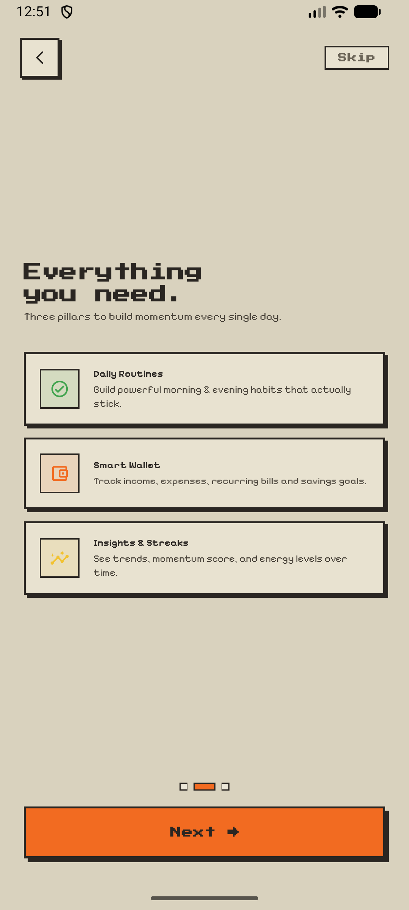
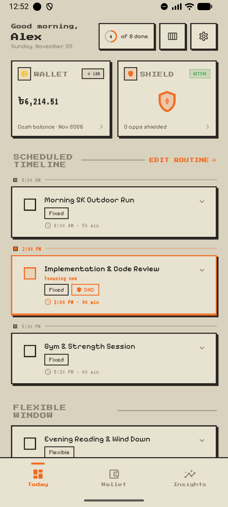
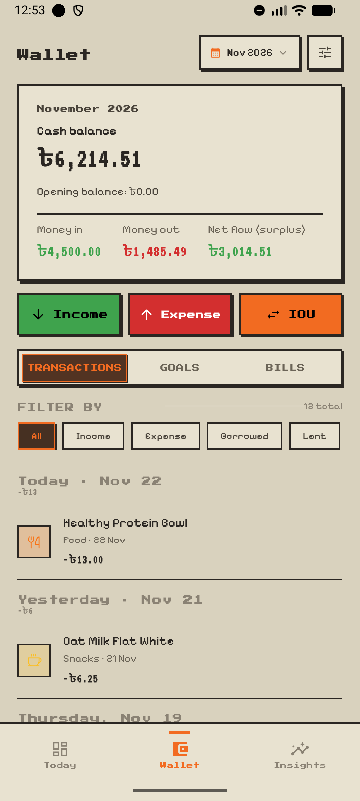
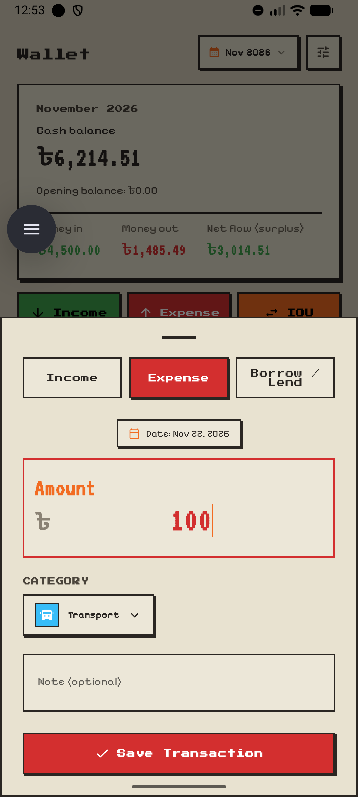
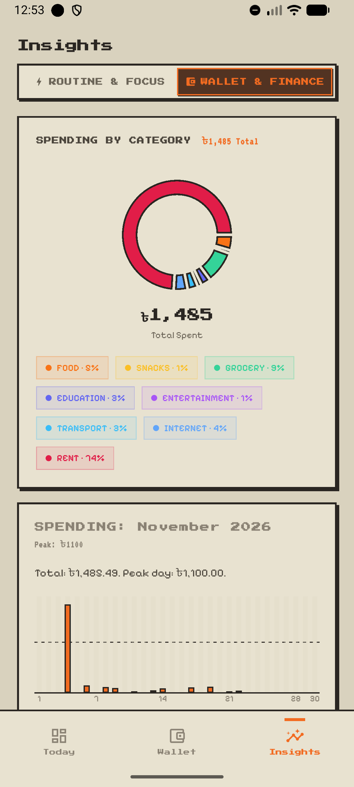

<p align="center">
  
</p>

<h1 align="center">Momentum</h1>

<p align="center">
  A personal daily routine, habit, and finance tracker for Android.
</p>

<p align="center">
  <a href="#-download">
    
  </a>
  &nbsp;
  
  &nbsp;
  
  &nbsp;
  
  &nbsp;
  
</p>

---

Momentum helps you structure your day through scheduled task blocks, track your finances month by month, and reflect on your performance with end-of-day logging and weekly analytics — all stored privately on your device.

---

## 📸 Screenshots

<p align="center">
  
  
  
</p>

<p align="center">
  
  
  
</p>

---

## 🚀 What's New in v2.0.0

- **Retro theme** with pixel typography and light and dark palettes. Classic styling is also available in Profile.
- **Wallet updates** with transaction editing, spending breakdowns, and month-by-month history.
- **Routine and review updates** with a weekly planner, a guided task editor, and saved daily reviews.
- **Focus Shield** with a themed Android overlay and emergency passes for interruptions.

---

## ✨ Features

### 🌓 Appearance & Themes
- **Retro Light** is the default. Choose **Classic** or **Retro** styling with light and dark appearances
- Themes apply across screens and the Android home-screen widget
- Bundled fonts work offline

### 🗓️ Today (Dashboard)
- Personalized greeting with time-aware salutation
- Live progress pill and animated health score
- Wallet summary card with inline income/expense logging
- Friday & Saturday weekend recognition (Sunday–Thursday workweek)
- Task list grouped by time block (Morning · Afternoon · Evening)
- Task cards with expand-to-act: mark done, skip, or reschedule
- Collapsible completed tasks and quick-add for ad-hoc tasks

### 🛡️ Focus Shield (Distraction Blocker)
- Native Android accessibility service monitoring foreground app launches
- Blocks distracting apps during active DND tasks
- Mindful Friction screen with breath-pacing pause and return-to-task shortcut
- 3 daily emergency passes for essential interruptions
- Granular app selection organized by category (Social, Games, Media, Messages)

### 💰 Wallet
- Running monthly balance with opening balance carry-forward
- Log income (tuition / freelance / other) and expenses (fixed / variable / borrowed / lent)
- Monthly budget progress bar with over-budget warning
- Semester savings goal tracker
- Browse monthly transaction history and edit existing entries

### 📊 Insights
- Weekly health score ring with animated arc and letter grade (A–F)
- Energy bar chart (Sun–Sat) from end-of-day logs
- 35-day consistency heatmap with score-based color intensity
- Spending by category and daily spending charts
- Budget discipline indicator and spending pace metrics

### 🌙 End-of-Day Log
- Open **Review Day** to reflect on tasks, energy, and spending
- Logs energy level, motivation, budget adherence, and free-text notes
- Calculates a health score from task completion weighted by type
- Displays a read-only summary card if today is already logged

### 🔧 Routine Builder & Task Wizard
- 7-column weekly planner (Sun–Sat)
- Task types: **Fixed** (exact time), **Floating** (flex window), **Adhoc** (one-off)
- Interactive Task Wizard with presets and suggestion tags
- Per-task settings: duration, buffer time, Do Not Disturb toggle

### 🔔 Background & System
- Scheduled notifications for task reminders and EOD prompt
- Auto Do Not Disturb during tasks with DND enabled
- Android home screen widget — shows current task, next task, and daily progress
- WorkManager periodic refresh keeps the widget live without opening the app
- Automatic month rollover carrying wallet balance forward

---

## 📥 Download

Download a published APK from GitHub Releases.

1. Go to the [**Releases**](../../releases) page.
2. Download `Momentum.apk` from the release you want to install.
3. On your Android device, allow installation from unknown sources if prompted (**Settings → Apps → Special app access → Install unknown apps**).
4. Open the downloaded APK and install.

The current build requires **Android 7.0 (API 24)** or higher.

---

## 🔒 Privacy

All your data stays **on your device**. Momentum uses no cloud sync, no account, and no internet connection. Everything is stored locally using [Hive](https://pub.dev/packages/hive).

---

## 🛠️ Developer Guide

Everything below is for contributors and developers who want to build or modify Momentum.

### Prerequisites

- [Flutter SDK](https://docs.flutter.dev/get-started/install) (stable channel, 3.x)
- Android Studio or VS Code with the Flutter & Dart extensions
- Android device or emulator (API 24+)

### Getting Started

```bash
# 1. Clone the repo
git clone https://github.com/Shaswata28/Momentum.git
cd Momentum

# 2. Install dependencies
flutter pub get

# 3. Generate Hive type adapters
dart run build_runner build --delete-conflicting-outputs

# 4. Run in debug mode
flutter run

# 5. Build a release APK
flutter build apk --release
```

The release APK will be at `build/app/outputs/flutter-apk/app-release.apk` (or `Momentum.apk`).

### Tech Stack

| Layer | Library |
|---|---|
| UI | Flutter + Material 3 |
| State | Riverpod |
| Storage | Hive (offline, no cloud) |
| Notifications | flutter_local_notifications + timezone |
| Home Widget | home_widget + WorkManager |
| Charts | fl_chart |

---

## 📄 License

This project is licensed under the MIT License — see the [LICENSE](LICENSE) file for details.
